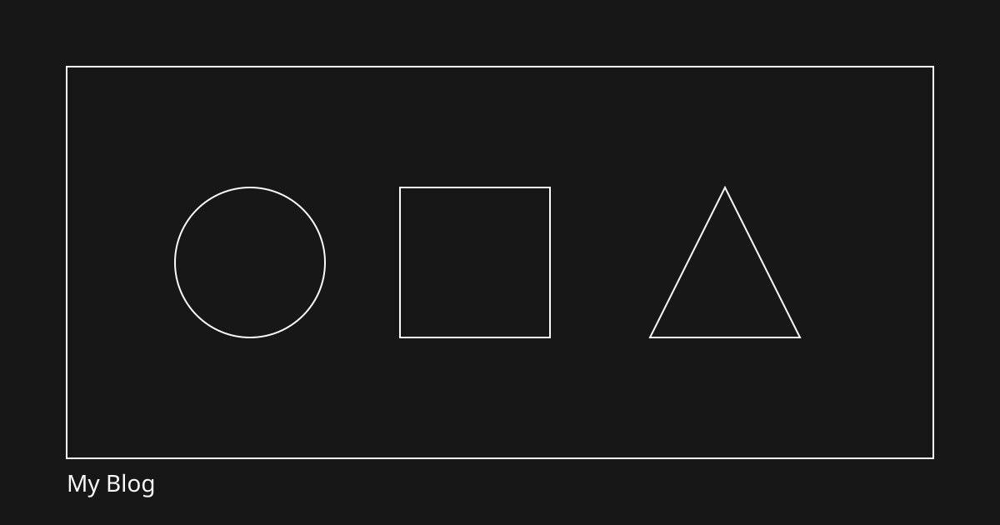

这篇用来验证一期的 Markdown 渲染能力。也可以引用其它文章，例如 @[hello-world]。

## 文本与列表

普通段落。也可以使用 ~~删除线~~。

- 无序列表 A
- 无序列表 B

1. 有序列表
2. 仍然有序

> 引用：内容与代码解耦，图片用相对路径。

## 任务列表

- [x] 支持 GFM
- [x] 代码高亮
- [ ] 二期编辑器（预留）

## 代码块

```js
console.log("hello");

function greet(name) {
  return `Hi, ${name}`;
}
```

```ts
type Post = {
  title: string;
  date: string;
};
```

行内代码：`pnpm dev`。

## 表格

| 列 A | 列 B |
| ---- | ---- |
| 1    | 2    |
| GFM  | 可用 |

## 图片（相对路径）

图片放在 `content/images/`，正文里这样引用：


## 小结

只要 frontmatter 合法、图片路径相对且落在 `content/images/`，构建产物就是自包含的静态站点。


